# Patent Yard v3: the light table

Branch `v3-visual-redesign` (worktree `~/PatentYard-v2`), started 2026-11-02 from `v2` at `3bdd51c`. Nothing is
deployed or pushed, and `main` and `v2` are unchanged. The brief is "Patent Yard v3, complete visual reimagining".
docs/REDESIGN.md (v2), docs/OVERHAUL.md and docs/REPORT.md still describe the earlier work, all of which is kept.

## 1. The creative direction

v2 changed the styling more than the composition: a centered headline over a search over a boxed drawing, then equal
card grids. v3 starts from what the product does: it takes an old invention, shows why it is free and helps
someone build a new one on top of it. That is what a draftsman's light table is for. You lay the original on lit
glass, and you trace the new design on vellum over it.

- **The table, the glass, the sheet, the vellum.**
  - The page is the table: a near-white `#F3F3F1` in light mode, charcoal `#121314` in dark.
  - Originals lie on panels of lit glass that run off the edge of the window.
  - Each drawing is a sheet: white paper with a soft shadow, framed by registration ticks rather than a box.
  - Everything Patent Yard adds (the record card, "In plain English", "Modern angle", the studio's brief) is set on
    frosted vellum laid over the original. So the patent's own material and Patent Yard's notes look different at a
    glance.
- **Graphite does the work; one vermilion mark.**
  - Buttons, selected chips and links are graphite.
  - One vermilion `#C23B27` (`#FF7D66` in dark) appears only on the thing that is live: keyboard focus, the
    plotter's pen and crosshair, the current section of a patent page, the current studio step and the chosen task.
  - Statuses keep their own colors and always carry their word.
- **Archivo in three widths, Source Serif 4 for the patent's words.**
  - Archivo is one variable font with a width axis. Display type is set expanded (118%), headings semi-expanded,
    the interface normal, and identifiers and dense data narrow.
  - Source Serif 4 is used only for the patent's own text (abstract, background, claims, description) and for the
    studio's prompt document.
  - Hanken Grotesk and the blue accent are gone.
- **Dark mode is the table at night.** The page goes charcoal and the glass stays lit, so every drawing keeps its
  original black ink on paper. Anything written on a lit panel switches to dark ink so it stays readable. Inverted
  drawings are still available as a setting (Settings, "Drawings in dark mode").
- **A new mark.** The logo is a registration target: the crosshair used to line up sheets on a light table.

### How it was chosen

Three homepage prototypes were built as real pages with real data (`web/dev/prototypes/`, image below):

| | Direction | Verdict |
|---|---|---|
| A | **Light table.** The drawing on lit glass, the record on a vellum card, split hero. | Chosen. Strongest first impression and identity, the clearest link between headline and drawing, and the same material explains the patent page and the studio. |
| B | **Catalogue.** The drawing as an object on a studio sweep, a specification table, a model number. | Clean and credible, but reads as a well-made product page; less of its own. |
| C | **Reference numerals.** The drawing's lead lines run out to the facts. | Declined: lines pointing at parts of a drawing say those parts mean something, which the page can't back up. It was also fragile on phones. |

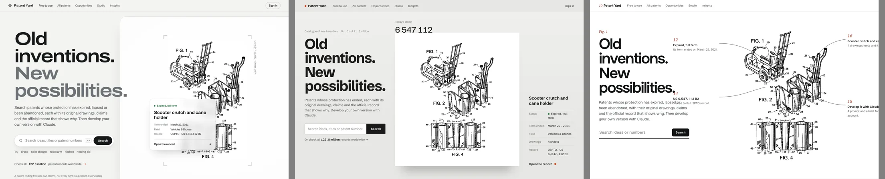

The design skill's direction roll also dealt six outside "worlds" (a glazier's glass wall, a tiled station hall, a
particle-detector display, a HyperCard stack, a pulp paperback rack, TV captions). None of them won, but four ideas
were taken from them:
- Color is reserved for what matters now.
- The record and its reinvention are one object: the brief is laid over the patent.
- Focusing on a drawing dims everything else, as in the full-screen viewer.
- The chosen sheet sits face-out while the rest show as spines, as in today's picks.

## 2. Before and after

Each image shows v2 on the left and v3 on the right, from the top of the page.

| | Desktop (1440 wide) | Phone (390 wide) |
|---|---|---|
| Home | 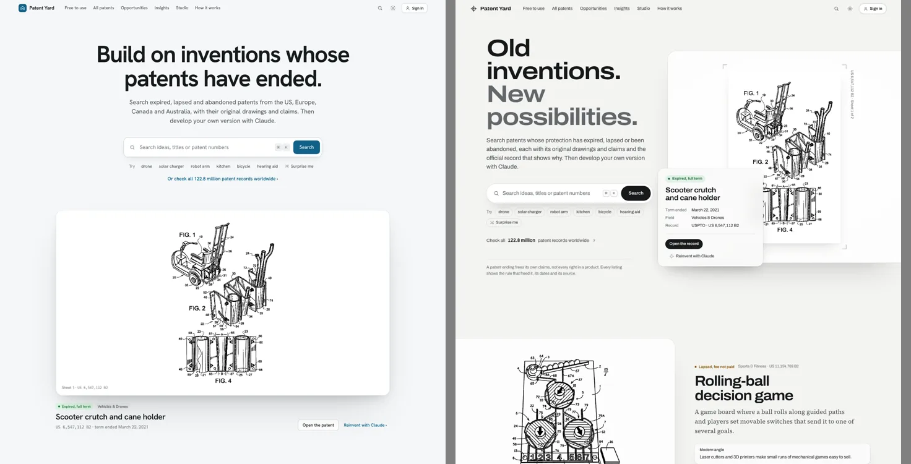 | 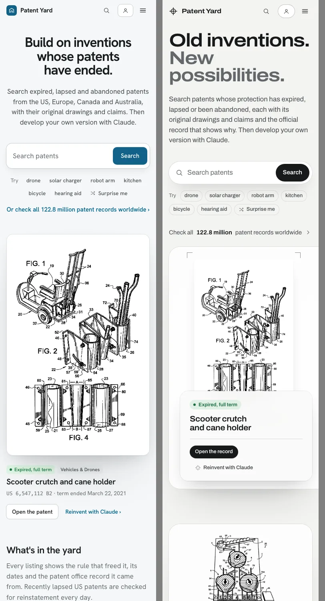 |
| Register | 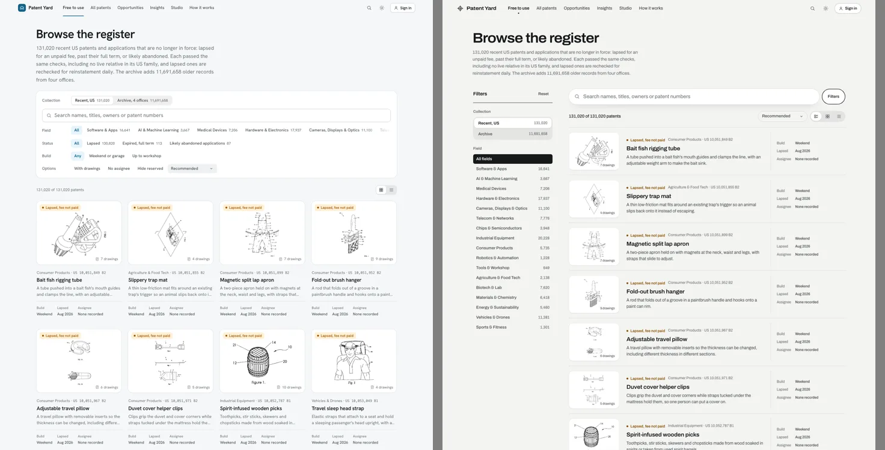 | 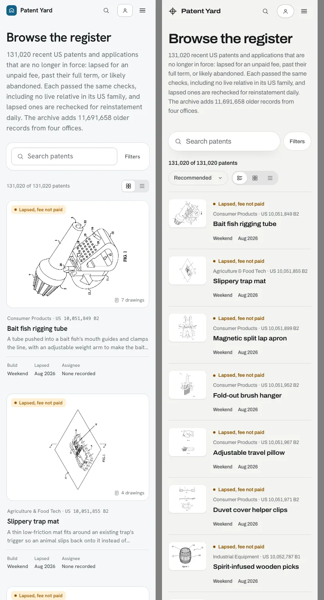 |
| Patent page | 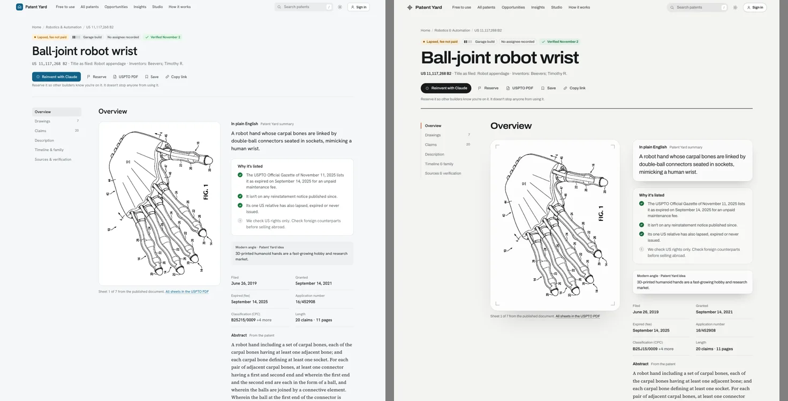 | 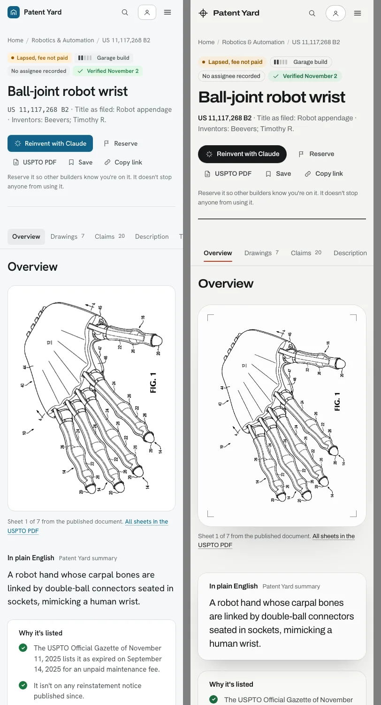 |
| Studio | 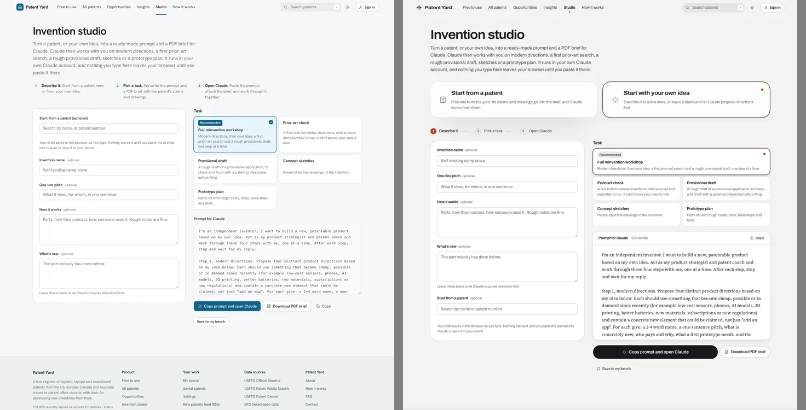 | 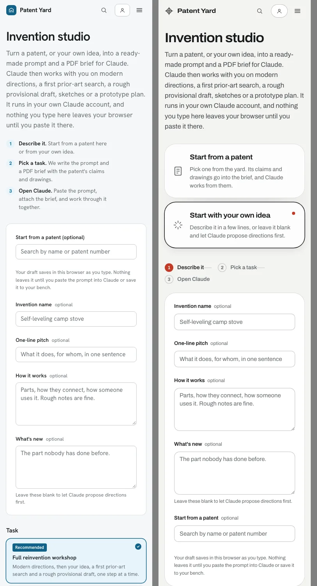 |
| Opportunities | 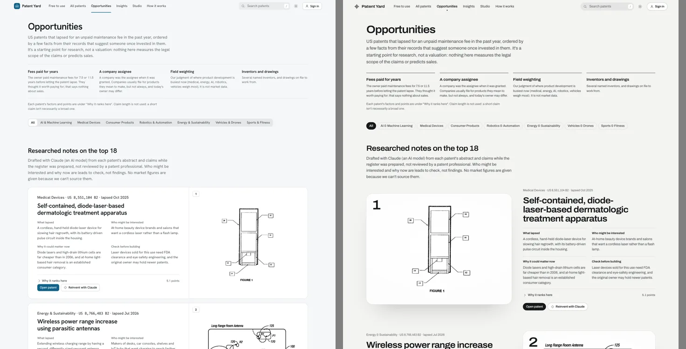 | 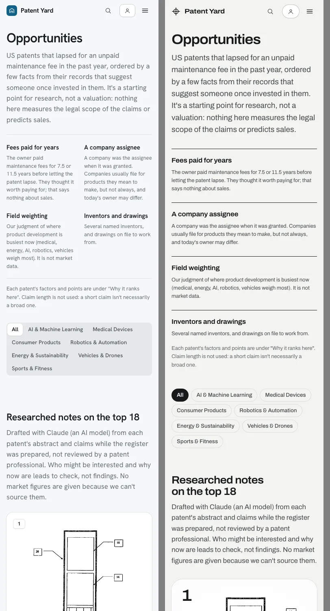 |

Dark mode (home, register, patent): 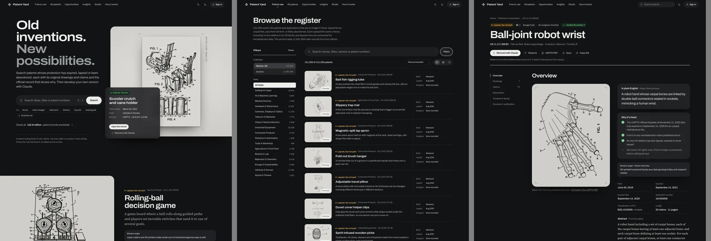

Full-page screenshots of nine pages at both widths in both themes can be regenerated with `web/dev/visual.mjs` (section 7).

## 3. What changed, page by page

### Home: a product launch
- **The first screen is split.** On the left: "Old inventions. New possibilities." in two tones, a short lede that
  says what is free and why, the search pill, words to try, and "Check all 122.8 million patent records worldwide".
  Below them, one line of qualification: a patent ending frees its own claims, not every right in a product.
- **On the right, today's drawing on its glass.** It runs to the window's edge. The pen plotter redraws it stroke by
  stroke with the vermilion pen, and a round loupe magnifies the sheet under the pointer. The sheet has corner
  ticks, its number and sheet count set vertically in the margin, and the record on vellum over its corner (status,
  title, date the term ended, field, record, "Open the record", "Reinvent with Claude").
- **One invention, up close.** The lead pick at full scale, its glass bleeding off the left edge. Its plain-English
  summary is set in the serif, with the modern angle on vellum.
- **What's in the yard.** Three counted numbers in large type, each saying what it counts and where it comes from:
  - patents whose protection has ended, from four offices;
  - patent records worldwide, "in force or not … not all of them are free to use";
  - US patents added this week.
  Then the four offices as a ruled ledger with links.
- **More from today's yard.** One sheet face-out on glass, three more as rows beside it, and six as a ruled list.
- **Explore by field.** An index with name, leader and count in three columns, without icons.
- **From an old patent to your own invention.** Discover, Investigate and Develop, each with a piece of the real
  interface built from real data: a search with two real results, the actual "Why it's listed" checks for today's
  patent, and the studio's real task list.
- **Have your own idea?** The studio's real opening prompt on vellum, laid over a patent on glass.

### Register, field pages and All patents: research software
- **Layout.** A pill search bar over the results, a sidebar of grouped filters beside them, and a toolbar with the
  count, sort and view switch.
- **Filters.** Groups are labelled; active options fill with graphite; "Reset" starts over. The Filters button
  folds the sidebar away on wide screens (the choice is remembered in this browser) and opens it as a sheet from the
  bottom on phones, with "Show results".
- **Three views from one markup.** List (new, and the default) is a research row: the sheet, the words, and the
  facts in their own column. Cards lays the sheets out on the table. Table is one dense line each. The page is
  served in list view, so nothing shifts as it loads.
- **Records with no drawing** show a typographic sheet (the number inside corner ticks) instead of an icon.
- **All patents** keeps its data caveat behind "About this data", so the search leads the page.

### Patent pages: a technical publication
- A masthead with the status labels, a large title, the number and filing details, and one row of actions, closed
  by a graphite rule.
- A contents rail that marks the current section in vermilion.
- The first sheet on glass with corner ticks; Patent Yard's summary on vellum. The abstract, background, claims and
  description are in the serif.
- A cut background excerpt now ends at a sentence or a word and says it continues in the description.
- Claims, timeline, family and sources keep their structure, restyled.

### Opportunities: a research note
- The method is set as a ruled four-column statement.
- The top three researched picks are editorial features: rank, large drawing, title, the four notes and "Why it
  ranks here".
- Picks 4 to 18 are rows whose notes open in place, and the next 96 form a compact ranked list.
- The ranking and its wording are unchanged.

### Studio: a workspace
- Two ways in, "Start from a patent" and "Start with your own idea". Own idea is preselected unless a patent was
  given or was in the draft.
- Three stages with the current one marked.
- The idea on a plain panel, the tasks in a grid, and the prompt set as a document in the serif, with its word
  count and Copy in a bar.
- The prompt text, PDF brief, saving and draft logic are unchanged.

### Everything else
- **Sign-in** is a lit-glass card beside the account's benefits.
- **Bench, saved patents and settings** use grouped lists.
- **Insights** has graphite charts and large counted figures.
- **How it works, About, Contact, FAQ and the legal pages** open with a larger, wider title over a graphite rule.
- **The footer** carries the wordmark large and the full source credits.

## 4. What did not change

The visual work was kept apart from product logic. `git diff v2..HEAD` touches none of:
- the data pipeline (`pipeline/*.py` apart from one added unit test), classification, legal status, families or
  ranking (`site_ui/ranking.py`);
- Pages Functions (`web/functions/`), the Supabase schema and RLS (`web/supabase/`), `_headers` and the CSP;
- the Claude kit and PDF brief (`kit.js`), the backend client (`backend.js`), the catalog and search (`catalog.js`);
- the card renderer (`cards.js`).

Element ids and data attributes that scripts and tests use were kept. The Python and JavaScript card renderers
still produce identical markup.

Script changes are presentation only:
- `app.js`: list view and colors;
- `home.js`: pen color;
- `browse.js` and `all.js`: sidebar fold, Reset, Show results, and All patents keeping old results until new ones
  arrive so the page doesn't jump;
- `studio.js`: intent, stages and word count;
- `theme.js` and `settings.js`: the dark-mode drawings default;
- `account.js`: the password meter color.

## 5. Files

- **Styles:** every file in `web/styles/` was rewritten or revised. `tokens.css` is the new system.
- **Templates:** `site_ui/shell.py` (header, footer), `base.py` (logo, view switch, icon), `components.py` (filters,
  toolbar, list view by default), and `pages/` home, browse, all_patents, patent, opportunities, studio, account and
  content.
- **Assets:**
  - Archivo replaces Hanken Grotesk. It came from Google Fonts under the SIL OFL and was trimmed with fonttools to
    the widths and weights used (68 KB).
  - New favicon, touch icon and `.ico`.
- **Tools:**
  - `web/dev/visual.mjs` (visual regression).
  - `web/dev/prototypes/` (the three prototypes).
  - `web/dev/fixtures.py`: the sample site is built as of one fixed day.
  - `web/dev/smoke.js`: the home check follows the new sections.
- **Docs:** this report, `docs/v3/` (images), DEVELOPING.md, PRODUCT.md (visual reference) and DESIGN.md with
  `.impeccable/design.json` (rewritten from the build).

## 6. Test results (2026-11-03, the real-data preview unless noted)

| Check | Result |
|---|---|
| Unit tests (`pipeline/test_pipeline.py`) | 32/32, one new: excerpts end cleanly |
| Card contract (`web/dev/test_cards.mjs`) | 5/5 identical in Python and JavaScript |
| Smoke suites (`web/dev/check.mjs`, mock backend) | header 8/8, home 6/6, browse 17/17, patent 24/24, studio 6/6, account 2/2 |
| No sideways scroll | home, register, a patent, studio, account, settings and how it works at 320, 390 and 768 px. Also checked at 320: All patents, Opportunities, Insights, fields, saved, about. |
| Functional checks | 11/11: account library, contact form and honeypot, Studio prompt with the patent and careful rights wording, prior-art task without a score, PDF brief downloads, no third-party hosts |
| All patents filters and number lookup | 17/17, twice |
| Review-fix checks | 16/16: sidebar folds and is remembered, filters still filter, dark mode shows original sheets on lit glass, the setting inverts them, Studio preselects, Opportunities rows open and filter |
| Keyboard | every tab stop on six pages, light and dark, shows a focus ring |
| Lighthouse accessibility | 100 on home, register, a patent page, Studio, Opportunities, All patents, account, settings, Insights, how it works |
| Lighthouse performance (mobile emulation) | home 94, register 97 to 98, patent 94, Studio 95 to 96, Opportunities 97, All patents 98, account 97, settings 98 |
| Best practices | 100 |
| Sample-data site (`fixtures.py`) | `check.mjs` passes. Two captures with `visual.mjs` are identical (32/32 pages, light and dark, 1440 and 390). |
| Design detector (impeccable) | only "outside DESIGN.md" advisories from before DESIGN.md was rewritten, and the press spring's overshoot |
| Finish review (independent design reviewer) | First pass: fix, with 8 material issues. All applied. Verdict pass: 5 resolved, 3 partial. The 3 partial items and the one regression it found were then fixed: compact Opportunities rows, smaller no-drawing plates, numbers that wrap instead of being cut, and a third row beside the lead pick. |
| Full production build (`pipeline.py web`) | passed, see 6a |

### 6a. Full production build

`python3 pipeline/pipeline.py web` on the branch with real data (2026-11-03) passed in 1,215 s:
- 131,027 patents in 1,024 shards;
- 11,699,368 archive records;
- 14,318 files, 11.1 GB (Cloudflare Pages allows 20,000 files);
- no file over 25 MiB;
- the build's link check across every page found no broken links.

It was built into the worktree's own `web/dist`; nothing was deployed.

## 7. Visual regression

`node web/dev/visual.mjs BASE OUT` takes full-page screenshots of nine pages (home, register, a patent, Opportunities,
Studio, account, settings, All patents, Insights) at 1440 and 390 px, light and dark, with motion settled. With
`--against GOLD` it compares each page with an earlier set:
- A page fails when its height changes or more than 0.5% of its pixels move by more than 48 of 255 in any channel,
  so anti-aliasing passes.
- A failure writes a `.diff.png` with the changes in red.

Use the sample site for goldens: it holds no account data and is built as of one fixed day. The goldens aren't
committed; make them from the commit you compare against (DEVELOPING.md, "Checks").

## 8. Remaining limitations

- **The independent review of worldwide status, date-only formatting and Studio eligibility** wasn't in the
  repository, its issues or this session, so none of its fixes are in v3. When it's shared, its fixes go in as
  separate, separately tested commits.
- **Drawing resolution.** The cropped sheets are about 435 to 520 px wide. v3 shows them at or near their own size
  (the up-close pick is never enlarged), but they can't be made sharper than their pixels.
- **Motion was judged in the browser, not by the reviewer**, who saw reduced-motion stills: the pen, the loupe, the
  card-to-patent view transition and the theme cross-fade. All stop under reduced motion.
- **Small layout shifts remain** on the account page (0.06, the sign-in form appears when the account library loads)
  and Studio (0.05, the patent picker).
- **The home page's largest paint is 2.9 s** on simulated mobile, because the display face loads before the
  headline settles. The font was trimmed from 90 to 68 KB; the plotter adds about 160 ms of main-thread work.
- **The "worldwide" figures need web/world**, as before. A clean clone builds the sample site, not All patents.
- **The USPTO sign-in change on 2026-11-07** is unchanged by this work (docs/REDESIGN.md section 9): the pipeline
  fails safely, and collecting new patents needs an Open Data Portal API key requested by an adult.

## 9. Deployment readiness

Ready for review, not deployed. Shipping means merging `v3-visual-redesign` into `main` (the publisher builds and
deploys within two hours) or a manual deploy, and both need Sanjay's go-ahead. The first full build after the merge
rewrites every shard, so the whole site switches at once. Visitors who had chosen inverted drawings keep them;
everyone else now sees the original sheets in dark mode.
